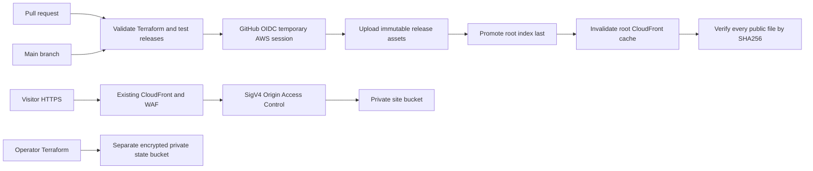

# AWS Cloud Engineering Portfolio

A public personal portfolio delivered through Amazon CloudFront and a private Amazon S3 origin. This repository adds Terraform ownership of the existing hosting and a GitHub Actions deployment/rollback implementation. It is an independent engineering project, separate from employer environments.

**Live website:** https://d25v5xu84onas.cloudfront.net/

## Architecture



Terraform manages the imported site bucket, public-access block, bucket policy, OAC and distribution. The existing WAF association is preserved; this project does not manage WAF rules. Terraform also defines a separate state bucket and a GitHub OIDC deployment role. CloudFront's URL and original resources are preserved.

## Delivery design

- Pull requests validate Terraform, JavaScript, local assets and release behavior. They receive no AWS credentials.
- Main-branch deployment uses short-lived GitHub OIDC credentials. Its role can read/write only the site entry page and `releases/*`, and create/read invalidations for this distribution.
- No access keys, Terraform state or plan files belong in Git. The deployment role cannot change infrastructure, IAM, the state bucket, or delete objects.
- Each release is stored under `releases/<full-commit-sha>/`. All static and dynamically inserted asset references point into that release. Release files use conditional writes and cannot silently overwrite a different payload.
- The root `index.html` is promoted only after all referenced files exist. It uses `no-cache`; release assets use immutable caching. CloudFront invalidation completes before checksum verification.
- Rollback promotes a saved entry page and verifies the full saved release. It does not rebuild old source with new dependencies or delete the current release.

See [deployment and rollback](docs/OPERATIONS.md), [Terraform adoption](infra/README.md) and [validation evidence](docs/VALIDATION.md).

## Local checks

```bash
python3 -m unittest discover -s tests -v
python3 scripts/release.py --sha 0000000000000000000000000000000000000000
node --check site/app.js
terraform -chdir=infra fmt -check
terraform -chdir=infra init -backend=false -input=false -lockfile=readonly
terraform -chdir=infra validate
```

Preview the original portable source with `python3 -m http.server 8775 --directory site`. Built release assets use absolute `/releases/<sha>/` paths intended for the deployed origin.

## Boundaries and cost

No EC2, VPN, database, custom domain or Route 53 resource is needed for this website. S3 storage and requests, CloudFront usage and any pre-existing WAF plan remain subject to the account's AWS pricing. The new private state bucket stores small state files; release history grows with deployments. No automated lifecycle deletion is enabled. Review retained releases before deciding to remove them; the pipeline deliberately has no delete permission.

This is a controlled release/rollback demonstration, not a zero-downtime SLA, load test or multi-region disaster-recovery claim. See the validation document for executed results and remaining limitations.
